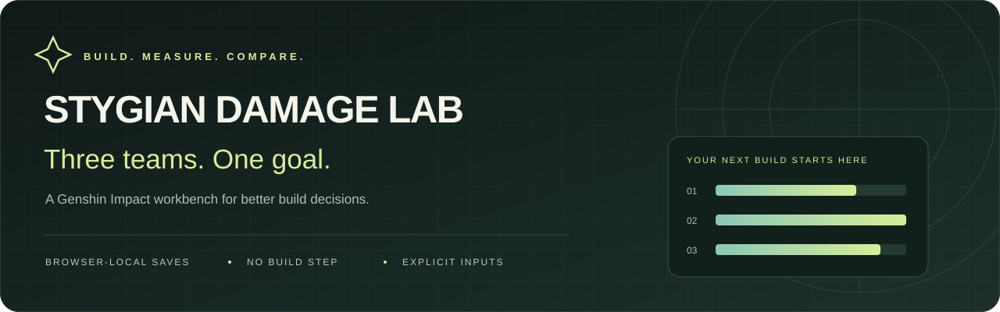
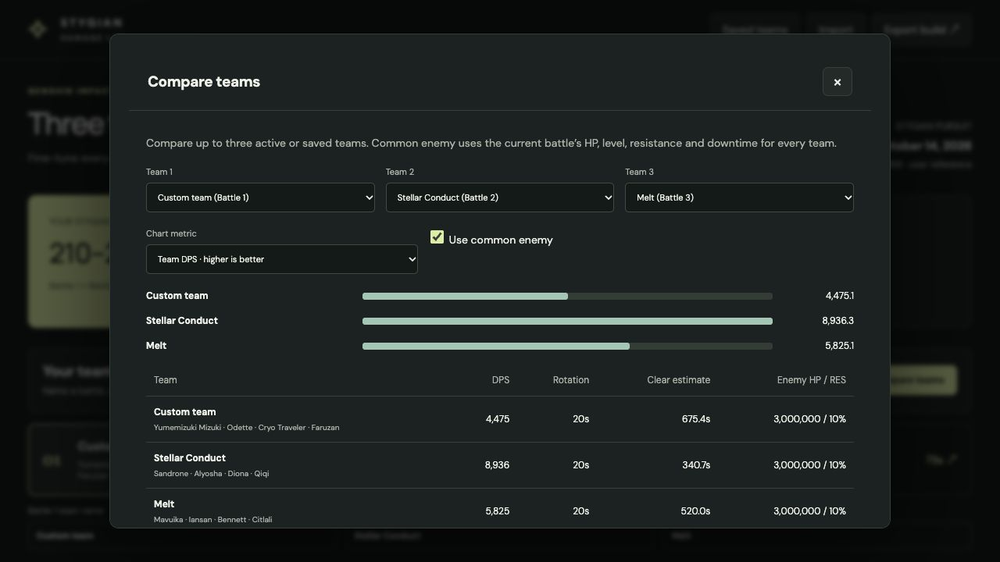
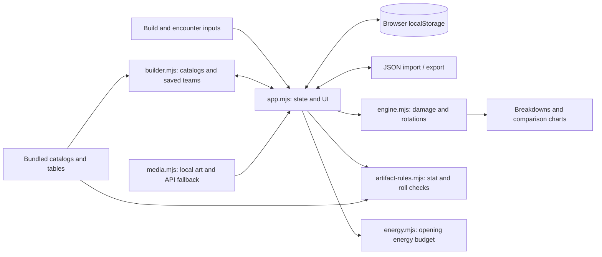

<div align="center">



# Stygian Damage Lab

**Turn “what if I changed this build?” into a side-by-side comparison.**

A visual Genshin Impact damage workbench for building teams, checking artifact rolls,
budgeting opening energy, and comparing the rotations you design.

[](https://github.com/Skeeb32/stygian-damage-lab)
[](https://github.com/Skeeb32/stygian-damage-lab/forks)
[](https://github.com/Skeeb32/stygian-damage-lab/commits/main/)


[**Run it locally →**](#quick-start) · [Explore the features](#inside-the-lab) · [Read the architecture](#under-the-hood) · [Contribute](#build-with-us)

</div>

---

## See your teams side by side



<p align="center"><sub>Actual app capture. Values reflect the entered example builds; they are not benchmarks or verified in-game clear times.</sub></p>

Choose up to **three active or saved teams**, switch between DPS, rotation damage, and estimated clear time, and optionally give every team the same enemy assumptions. Keep a baseline, change a build, and see what moved.

The [hosted workspace](https://stygian-damage-lab.shaqib-dev.chatgpt.site/) currently has restricted access. The local version below runs without a sign-in or API key.

## Why this exists

A build decision rarely involves just one number. A weapon changes stats; artifacts change scaling; a teammate changes available buffs; a boss changes the damage window. Stygian Damage Lab puts those inputs and their consequences in one place.

The project began with a personal three-battle Stygian plan and a **210–218-second target**. It grew into a reusable workbench: searchable equipment, named team saves, explicit combat inputs, and comparisons you can revisit. That target remains a reference in the UI, not a performance claim.

## Inside the lab

| Capability | What you can do |
| :--- | :--- |
| **🧩 Build a roster** | Edit three four-character teams. Browse every character in the live Genshin-DB catalog, split across pages, and filter by element, weapon type, or 4★ / 5★ rarity. A bundled list remains available if the API is offline. |
| **⚔️ Tune the equipment** | Record levels, constellations, talents, weapons, refinements, and numerical stats. See weapon art and **4-piece / 2-piece + 2-piece** sets on character cards. |
| **💎 Check artifact inputs** | Use slot-specific main stats, rarity/level tables, legal single-roll increments, duplicate-stat checks, and roll-budget warnings. Existing questionable values remain visible for correction. |
| **📐 Inspect damage** | View non-CRIT, CRIT, and average damage, character contributions, rotation totals, DPS, and an HP-based clear estimate. Configure buffs with recipient, element, and uptime controls. |
| **⚡ Budget opening energy** | Start at zero. Enter skill particles, Favonius procs, boss particles/orbs, and flat-energy events; account for catcher, element, and Energy Recharge. |
| **🎯 Set the encounter** | Apply bundled Stygian 7.1 boss HP, level, and a selected resistance window, or enter your own enemy assumptions. |
| **📊 Compare alternatives** | Compare up to three teams with a metric selector and optional common enemy. Save a separate comparison baseline while editing. |
| **💾 Keep your experiments** | Save, load, rename, overwrite, and delete named teams in browser storage. Export/import JSON to back up builds and the saved-team library. |

### Repository snapshot

| Character catalog records | Weapon catalog records | Artifact-set records | Bundled artwork files |
| :---: | :---: | :---: | :---: |
| **124** | **255** | **63** | **38** |

<sub>Counts from the checked-in catalog and assets at this README revision. Catalog availability does not mean every character's mechanics or equipment passive is automatically modeled.</sub>

## Quick start

**Prerequisites:** Git, Python 3 for the local static server, and a modern browser. Install a current Node.js LTS release if you want to run the formula checks.

### 1. Clone

```sh
git clone https://github.com/Skeeb32/stygian-damage-lab.git
cd stygian-damage-lab
```

### 2. Serve

```sh
python3 -m http.server 8766 --bind 127.0.0.1 --directory dist
```

### 3. Open

Visit **[http://localhost:8766](http://localhost:8766)**. Stop the server with `Ctrl+C`.

There is no package installation, `.env` configuration, API key, or build command. The browser loads native JavaScript modules directly. Use the HTTP server rather than opening `index.html` as a file, because the app fetches local JSON and imports modules.

<details>
<summary><strong>Troubleshooting & deployment</strong></summary>

- **Port in use:** change `8766` to another available port and open the matching address.
- **Missing artwork:** some images and fallback lookups require internet access. The app provides image fallbacks when these requests fail.
- **Missing saved teams:** storage belongs to the browser profile and site origin. A different hostname, port, device, or browser has a different library. Export before moving or clearing browser data.
- **Deploy elsewhere:** publish the contents of `dist/` as the root of a static website. Preserve relative paths and serve `.mjs` files as JavaScript. No compilation is needed. Hosted publication is separate from this repository; no deployment workflow is checked in.

</details>

## Your first experiment

1. **Name a battle.** Use the team-name fields, then select a character card and browse the catalog to replace a roster slot.
2. **Enter the real build.** Configure character/weapon stats, artifact pieces, and exact attack coefficients. Newly selected characters begin with example inputs.
3. **Enable eligible buffs.** Set their values, recipients, and uptime. Equipment names and refinements alone do not apply every passive.
4. **Define the encounter.** Enter enemy HP, level, resistance, and downtime, or apply a bundled boss window.
5. **Check Energy.** Enter burst costs and the events your opening produces. Review deficits before assuming the rotation is executable.
6. **Save and compare.** Save a named team, change a weapon or teammate, save another version, and open **Compare teams**. Enable **Use common enemy** for a consistent comparison.
7. **Export a backup.** Keep the JSON file to restore your work later or transfer it to another browser.

## Under the hood

**Vanilla JavaScript · native ES modules · HTML/CSS · localStorage · Fetch API · Node.js assertions**



| Engineering decision | Why it matters |
| :--- | :--- |
| **Separate calculation modules** | Damage, artifact rules, and energy estimation can be inspected independently of the DOM. Formula checks import the damage engine directly. |
| **Explicit combat inputs** | Buff eligibility, coefficients, enemy resistance, and rotation length are visible assumptions. The output can be traced back to the entered build. |
| **Browser-local persistence** | Team experiments need no application database. JSON exports provide a portable backup format. |
| **Fresh catalog, safe fallback** | The character picker refreshes its catalog from Genshin-DB when opened, caches a successful response in the browser for six hours, and falls back to checked-in JSON when offline. Portraits use current HoYoWiki image URLs instead of retired icon links. |
| **Validated imports** | Import checks cover structure, numeric bounds, allowed stats/actions, saved-team records, and forbidden object keys before replacing the current state. |
| **Static delivery** | The application ships as HTML, CSS, JSON, assets, and nine ES modules, with no frontend framework or package dependency manifest. |

<details>
<summary><strong>Source map — where to start reading</strong></summary>

```text
stygian-damage-lab/
├── dist/
│   ├── index.html              # Browser entry point
│   ├── style.css               # Responsive dark interface
│   ├── app.mjs                 # State, editor, rendering, import/export
│   ├── builder.mjs             # Catalog pickers, saved teams, comparison
│   ├── engine.mjs              # Stats, buffs, damage, rotation totals
│   ├── artifact-rules.mjs      # Slot constraints and roll validation
│   ├── artifact-tables.mjs     # Main-stat progression and substat rolls
│   ├── energy.mjs              # Zero-start energy calculations
│   ├── data.mjs                # Initial teams, stat names, presets
│   ├── media.mjs               # Artwork resolution and fallbacks
│   ├── media-catalog.mjs       # Bundled artwork mapping
│   ├── game-catalog.json       # Searchable equipment/character records
│   ├── stygian-bosses.json     # Dated boss snapshot
│   └── assets/                # Local game artwork
├── docs/assets/               # README banner and app screenshot
├── scripts/update-character-catalog.mjs # Refresh bundled character fallback data
├── test.mjs                   # Formula regression assertions
└── README.md
```

Despite its name, **`dist/` contains the editable application source**. There is no separate build-generated source tree.

</details>

## What the numbers mean

The engine supports ordinary damage, amplifying Melt/Vaporize variants, ordinary Swirl, and the app's Stellar Swirl/Conduct modes. It applies the implemented resistance branches, defense modifiers where relevant, and average CRIT weighting.

```text
Team damage = sum of (entered attack damage × hit count) + extra damage
Team DPS    = team damage / entered rotation duration
Clear time  = enemy HP / team DPS + entered downtime
```

**This is an input-driven workbench.** Levels, talents, constellations, refinements, and set names do not automatically resolve all of their numerical effects. Sample stats and coefficients must be replaced with verified values. Element-specific ordinary damage uses the character's selected element; mixed-element actions need separate configurations.

Energy is a total budget, not a timed rotation simulation. It does not automatically gate damage results. Aura application, cooldowns, special-resource mechanics, shields, overkill, and boss transitions are not simulated. Boss data is a dated **7.1 snapshot**, checked on **October 21, 2026**, rather than a live boss API feed.

The character picker checks Genshin-DB when opened and caches the list for six hours. Its API generally follows the main data package by one to two days, so newly released characters may take a short time to appear upstream. To update the repository's offline fallback, run `node scripts/update-character-catalog.mjs` from the project root. The current bundled catalog is **v7.1**.

## Verification & project activity

Run the repository's formula checks:

```sh
node test.mjs
```

The suite checks ordinary/amplifying damage, Stellar formula branches, resistance branches, CRIT caps, DEF/DMG exclusions, ordinary Swirl's CRIT behavior, and positive rotation totals for the presets. It uses Node's built-in `assert` module with no test-package installation.

The badges above show live GitHub stars, forks, and last-commit activity. Browse the [commit history](https://github.com/Skeeb32/stygian-damage-lab/commits/main/) and [contributors](https://github.com/Skeeb32/stygian-damage-lab/graphs/contributors) for the underlying record. **Automated CI and measured coverage are not configured in this repository yet.**

## Roadmap

**Available today**

- [x] Searchable roster/equipment catalogs and visual character cards
- [x] Named team library, JSON backups, and three-team comparison
- [x] Artifact slot/level rules and legal-roll controls
- [x] Zero-start energy budgeting and selectable boss snapshots

**Proposed next steps — contributions welcome**

- [ ] Broader automated regression coverage for energy and artifact rules
- [ ] GitHub Actions for the existing formula checks
- [ ] Verified character/talent scaling and more weapon/passive presets
- [ ] Per-action elements and richer encounter modeling
- [ ] A repeatable, source-attributed catalog and boss-data refresh process

## Build with us

Found a formula discrepancy, awkward workflow, or missing preset? [Open an issue](https://github.com/Skeeb32/stygian-damage-lab/issues) with the inputs, expected result, actual result, and a source where relevant.

For a contribution:

1. Fork the repository and clone your fork using the quick-start instructions.
2. Create a focused branch: `git switch -c feat/your-change`.
3. Edit the relevant files in `dist/` and run the local server.
4. Run `node test.mjs`. For formula changes, add a regression assertion with a verifiable expected value. For UI changes, check a narrow viewport and include a screenshot.
5. Open a pull request explaining the problem, behavior change, validation, and any remaining model assumptions. Attribute new data and artwork sources.

Good starting points include formula regression cases, accessibility improvements, clearer validation messages, and data provenance. Please keep exported personal builds and credentials out of commits.

## For engineers & hiring teams

This project demonstrates taking a domain-heavy problem from data to an interactive product: constrained artifact inputs, numerical modeling, persistent user state, asynchronous media integration, and comparative visualization.

Start with [the calculation engine](dist/engine.mjs) and [its regression checks](test.mjs), then follow [artifact validation](dist/artifact-rules.mjs), [energy estimation](dist/energy.mjs), and [the builder workflow](dist/builder.mjs). Those modules show the main engineering tradeoffs directly, including the boundaries of the current model.

Built by [**Skeeb32**](https://github.com/Skeeb32).

## Sources & attribution

| Source | Used for |
| :--- | :--- |
| [genshin-db](https://github.com/theBowja/genshin-db) and [genshin-db API](https://github.com/theBowja/genshin-db-api) | Character, weapon, and artifact metadata; artwork references and fallback lookups |
| [Genshin Optimizer](https://github.com/frzyc/genshin-optimizer) | Artifact main-stat progression and substat roll tables |
| [KQM Theorycrafting Library](https://library.keqingmains.com/) | Damage and [energy](https://library.keqingmains.com/combat-mechanics/energy) references; additional formula links are included in the app |
| [Stygian.moe](https://www.stygian.moe/) | Bundled boss HP and resistance-window reference data |

Unofficial fan project, unaffiliated with HoYoverse. Genshin Impact and game artwork belong to their respective owners. No project license file is currently included; upstream data and artwork retain their respective rights and terms.

---

<div align="center">

**Make your next build a better-informed one.**

[Run the lab](#quick-start) · [Fork a new idea](https://github.com/Skeeb32/stygian-damage-lab/fork) · [Report a finding](https://github.com/Skeeb32/stygian-damage-lab/issues)

If this helps your theorycrafting—or inspires your next tool—**⭐ star the repository** and share it with your team.

</div>
